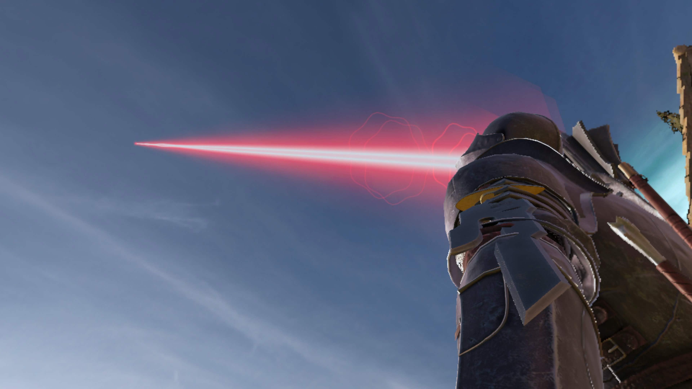
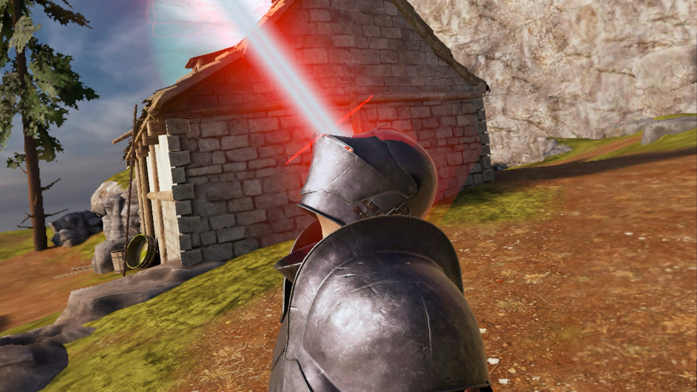

# The Chosen's Laser Vision

An experimental eye-beam spell for **Blade & Sorcery: Nomad**, developed around Quest 3. Fire focused twin beams, sweep your gaze to cut at an angle with Zandatsu, or charge a broader Overdrive wave.

**Creator:** ChiliCheeseDog (CurryLover99 on Nexus). **Current release:** 0.2.1.



## Requirements

- Blade & Sorcery: Nomad with scripted mod support. This is the Nomad release, not a PCVR release.
- **[Zandatsu 0.7.0 — Slice at Any Angle, by StainlessHalo](https://www.nexusmods.com/bladeandsorcerynomad/mods/8249)** for the intended directional mesh-cutting functionality. Install it separately; its code and assets are not bundled here.

The beam's damage, appearance, and audio can operate without Zandatsu, but its dynamic mesh slicing requires it. The integration targets the private interface in Zandatsu 0.7.0; other versions may need an update.

## Controls

| Action | Control |
| --- | --- |
| Equip | Select **The Chosen's Laser Vision** in either hand's spell wheel |
| Fire normal beams | Hold that hand's **trigger** |
| Aim | Look in the direction you want to fire |
| Directional cut | Sweep your head while firing; Zandatsu handles the cut plane |
| Charge Overdrive | Hold **trigger + grip on the casting hand** for about **half a second** |
| Return to normal beams | Release **grip** while continuing to hold trigger |
| Stop/cancel | Release **trigger** |

Normal beams continue during the charge. Overdrive adds a broader unstable wave, animated rings, tendrils, more damage, and stronger audio. It can be disabled in mod options.

## Features

- Focused eye beams that stop at blocking scenery, with optional enemy piercing.
- Directional Zandatsu mesh slicing and recutting of compatible detached body pieces.
- Three steady-contact modes: **CrushingPressure**, **Knockback**, and **DamageOnly**.
- Configurable damage, burning, push strength, range, beam thickness, core color, and glow color, including orange.
- Adjustable clearance near the face, a fading stereo smear, animated contact flares and sparks.
- Joined surface scorch strokes, residual heat, and local skin charring on supported game renderers.
- Heated Zandatsu cut edges when Burning and Zandatsu's **Fire Cuts Burn** are enabled.
- A custom stickman eye-beam spell-wheel icon.
- Charge, ignition, energy-loop, impact, and sweep audio.

**CrushingPressure is the default.** It sends localized blunt damage with contact information, without adding whole-body force. Choose **Knockback** if you want the spell to push enemies away. **DamageOnly** uses energy damage without added pressure or push.

The mod does not directly sculpt a face or carve a cylindrical hole through a body. A deformation mod may react to its blunt-hit events, but **Carnage Reborn compatibility is not verified**.



## Installation

1. Install Zandatsu 0.7.0 separately.
2. If upgrading from the early version, remove the old **PrismLaserVision** folder. Do not run both versions at once.
3. Extract the Nomad installer ZIP and copy its **TheChosensLaserVision** folder into:

   ```text
   Android/data/com.Warpfrog.BladeAndSorcery/files/Mods/
   ```

4. Confirm the path ends in `Mods/TheChosensLaserVision/manifest.json`. Public audio is generated at runtime; no Audio folder is required.
5. Fully restart Nomad, then select the spell in a sandbox level.

Download the complete installer from the project's release page or the Nexus/mod.io listing when available. The public release uses synthesized sound; it does not include the recordings supplied during private development.

## Settings and troubleshooting

Open the game's Mods options for **The Chosen's Laser Vision**. Damage, burning, slicing, and contact mode can be adjusted independently. Face clearance only changes rendering; collision still begins at the eyes.

For slicing, check that Zandatsu is enabled, its health threshold allows the target to be cut, and the game's dismemberment/content settings permit it. For heated cut edges, enable **Fire Cuts Burn** in Zandatsu. For detached-piece cuts, enable **Cut Pieces Again**.

If direct damage and burn damage are hard to distinguish, temporarily disable Burning. If pushing appears absent, select **Knockback** and raise Push strength. Ground scorch lifetime affects surface marks; native skin char lasts until the game resets that character's reveal mask.

## Release status

Version 0.2.1 is an **experimental release**. The earlier build received player testing, and the screenshots show the mod in Nomad. This does not establish universal compatibility or frame-rate guarantees. Overdrive, skin charring, sound balance, and interactions with other mods may need tuning.

The public build passed compilation. Automated math, cutting-adapter, and charge-input checks support development; these checks do not replace testing inside the game.

For bug reports, include the Nomad version, mod version, other relevant mods, contact mode, whether normal beams or Overdrive are affected, and any `[LaserVision]` log messages. Avoid posting private information in logs.

## Creation and credits

**ChiliCheeseDog (CurryLover99 on Nexus) created and directed this project:** the concept, feature choices, visual and sound direction, iteration, gameplay tuning, testing, and screenshots. Implementation was developed with **AI assistance using OpenAI Codex**. AI assistance is disclosed as part of the development process; the project's creative direction and iteration came from its creator.

**StainlessHalo** created Zandatsu and its mesh-cutting engine. This mod uses the separately installed Zandatsu at runtime and does not claim authorship of that engine.

The aesthetic takes inspiration from laser vision in Alan Becker's animation. This is an unofficial fan project and is not affiliated with Alan Becker or Warpfrog. The public release uses code-synthesized audio, with no copied animation/video audio or user-supplied recordings.

## Build and source

The root C# files contain the implementation. `Tests.zip` contains executable logic/contract tests. The root JSON files and thumbnail are the mod configuration assets. Game reference assemblies, Zandatsu binaries, and third-party audio recordings are not included.

Use **Build.ps1** with Roslyn and the official Nomad managed reference assemblies:

```powershell
.\Build.ps1 -ReferenceDirectory C:\modtools\nomad-managed -CompilerPath C:\modtools\roslyn\tasks\net472\csc.exe
```

Reference archive used during development: [official Nomad managed 1.0.7 references](https://raw.githubusercontent.com/KospY/BasSDK/gh-pages/assets/nomad-managed-1.0.7.zip). Compilation uses C# 7.3 and .NET Framework 4.7.2-compatible APIs. The older reference archive does not independently establish compatibility with every newer game patch.

The resulting `TheChosensLaserVision.dll` belongs beside the manifest and spell JSON in a complete mod installation. The internal spell ID remains `PrismLaserVision` for compatibility with the early build.

No public redistribution license has been selected for this source repository. Third-party dependencies retain their respective rights.


